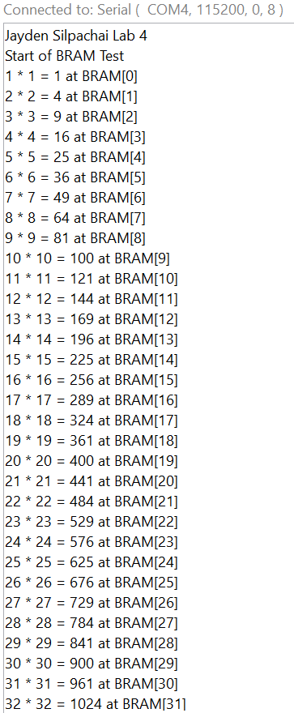
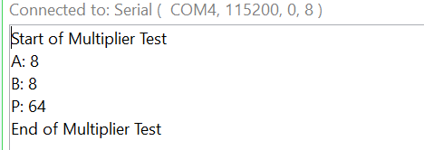
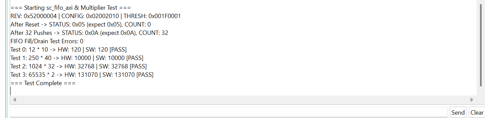

# Custom AXI4-Lite FIFO & Multiplier SoC
# Overview
The purpose of this lab is to use the IP Packaging feature within Vivado to create custom blocks for the Block Diagram to be used for a 16 bit Multiplier. The FIFO to be used in this lab was based on a prior project from earlier.

# Testing Strategy
For each designated task, after creating each project file and generating a bitstream for each, it is exported into Vitis IDE and a section of code can be written in order to test each custom task.

# Verification
For each section of code written, the project would be built and then run and the output would be viewed using the COM port while connected to the Zybo Z-7 board. The output for each test was screenshotted and verified by the instructor.

# Issues 
Often times the IP repo folder would be placed in an odd spot, and since each new project would create a new ip_repo folder, caution is required to ensure the correct folder was selected for the IP Repository.

# References
ECE520L_Lab_4_AXI_LITE_IP_manual

# Pictures

